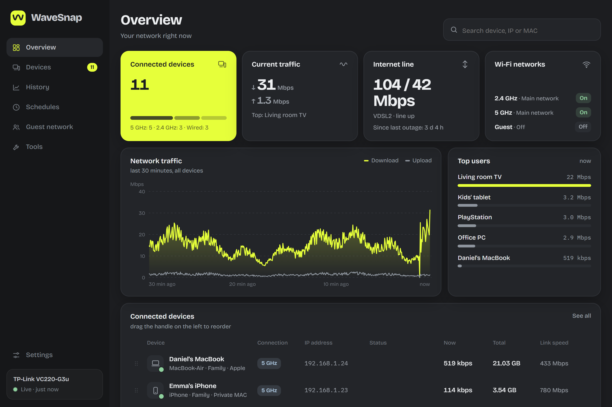
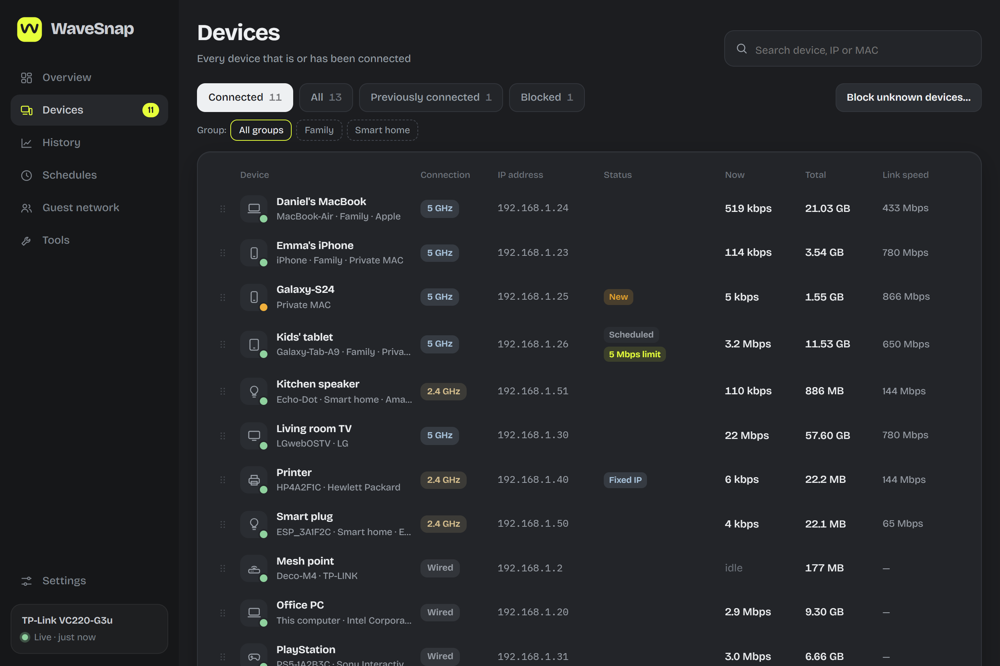
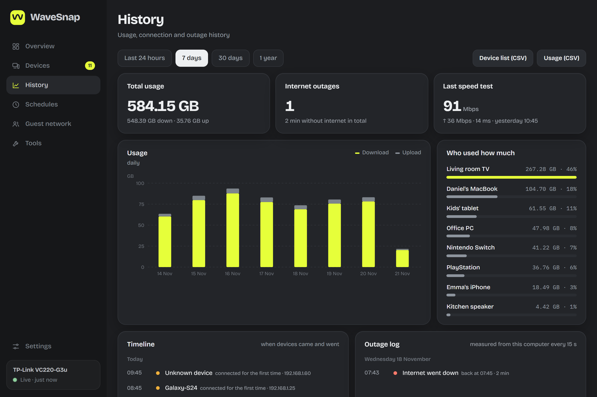
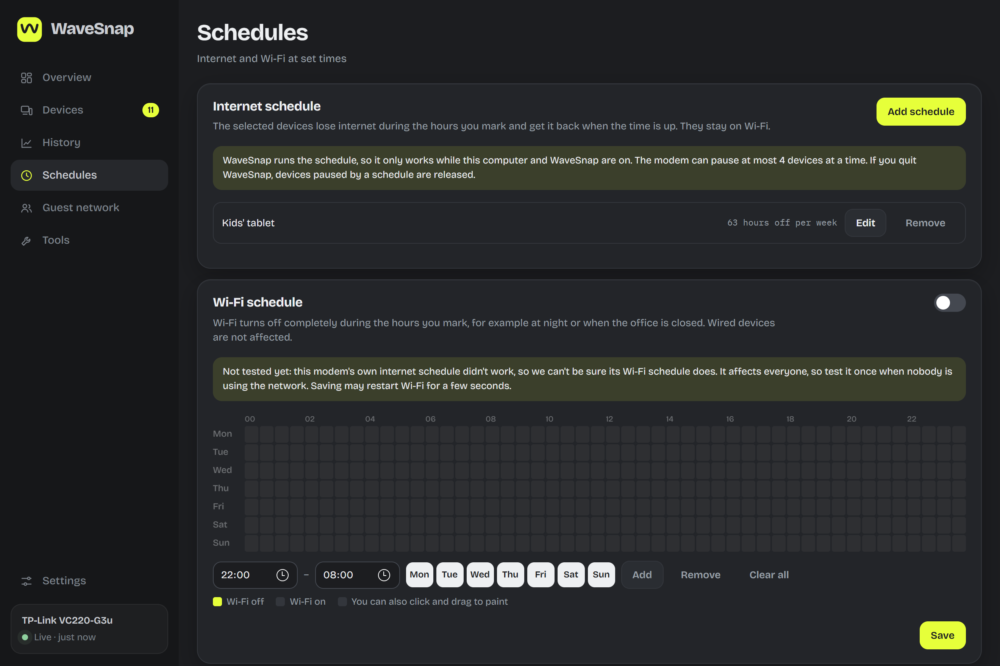
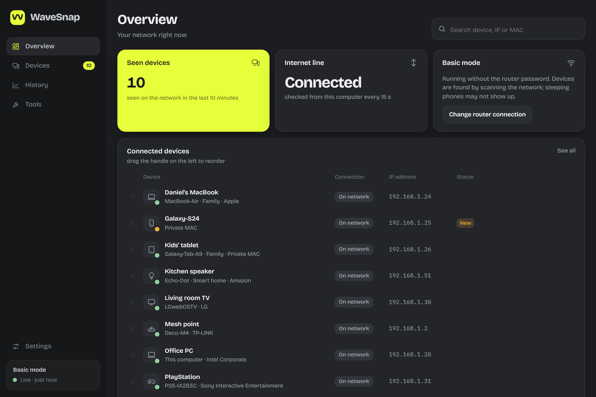

<p align="center">
  
</p>

<h1 align="center">WaveSnap</h1>

<p align="center">
  A calm, good-looking desktop panel for your home or office network.<br>
  See every device on your network, what it is using right now, and pause, limit or block it in one click.
</p>

<p align="center">
  
</p>

WaveSnap runs on **Windows, macOS and Linux** and works in one of two modes:

- **Full mode** talks to your router with its admin password, so it can pause, limit and block devices.
  Today this works with **TP-Link routers that use the same web interface as the VC220-G3u**.
  See [Supported routers](#supported-routers).
- **Basic mode** works with **any router** and needs no password. It finds devices by scanning your network
  and keeps an outage and speed-test history, but it cannot change anything on the router.

WaveSnap looks for your router when you first open it and suggests the right mode.

## What it does

- **Every device in one list.** You see each device's name, maker (from the MAC address), type, Wi-Fi band or
  cable, and IP. In full mode you also see its live speed and total usage.
  Devices that hide behind a private MAC are marked as such.
- **Pause the internet** for a device and resume it later. It stays on Wi-Fi but cannot reach the internet. *(full mode)*
- **Schedules.** For example, "no internet on the kids' tablet from 22:00 to 07:00", painted on a weekly grid. *(full mode)*
- **Speed limits** per device, **fixed IP addresses**, and **blocking** unknown devices from your Wi-Fi. *(full mode)*
- **History.** It records when devices came and went, internet outages (checked every 15 seconds) and speed tests.
  In full mode it also records who used how much, from 24 hours up to 1 year. You can export everything to CSV.
- **Guest Wi-Fi** with a QR code that phones can scan to join. *(full mode)*
- **Troubleshooting.** A step-by-step connection test (computer → router → line → internet → DNS). In full mode you
  also get line quality (sync speed and SNR), the router's logs and a restart button.
- **New-device alerts** as desktop notifications.
- Three themes (Storm Grey, Desert Sand, Electric Blue), English and Turkish. The layout adapts to any window size.

<p align="center">
  
  
</p>
<p align="center">
  
  
</p>

## Download

Get the latest version from the [Releases page](../../releases/latest).

| System | File | First start |
|---|---|---|
| Windows 10/11 | `WaveSnap-…-windows-setup.exe` | Run it. It installs for your user only and needs no admin rights. If Windows SmartScreen warns about an unknown publisher, choose **More info → Run anyway**. |
| macOS (Apple silicon) | `WaveSnap-…-macos-arm64.dmg` | Drag WaveSnap to Applications. The first time, right-click it and choose **Open**, then **Open** again. The app is not signed with an Apple certificate, so macOS asks once. |
| Linux (x86-64) | `WaveSnap-…-linux-x86_64.tar.gz` | Extract it and run `WaveSnap/wavesnap`. Run `WaveSnap/wavesnap --install-shortcut` once to add WaveSnap to your applications menu. |

WaveSnap opens in its own window. It uses Edge, Chrome, Chromium, Brave or Vivaldi in app mode if one of them is
installed, and your default browser otherwise. A portable Windows zip is also on the Releases page.

### Run from source

You need Python 3.11 or newer.

```
git clone https://github.com/barbiceps-md/wavesnap.git
cd wavesnap
pip install -r requirements.txt
python wavesnap.py
```

On Windows, `python kisayol_kur.py` adds a desktop and Start menu shortcut. On Linux,
`python wavesnap.py --install-shortcut` adds a menu entry.

## Try it without a router

```
python demo.py          # full mode
python demo.py --temel  # basic mode
```

Opens WaveSnap with a simulated router and made-up devices. Every button works, nothing touches your real network,
and the demo data is thrown away when you start it again. All the screenshots above come from demo mode.

## Privacy and security

- **No accounts, no cloud, no analytics.** Your device list and history never leave your computer.
  WaveSnap contacts only three things besides your router:
  - to detect outages, it opens and closes a connection to public DNS servers (`1.1.1.1`, `8.8.8.8`, `9.9.9.9`)
    every 15 seconds and sends no data;
  - the speed test, which you start yourself, uses Cloudflare's public speed-test server;
  - the connection test looks up `www.google.com` to check DNS.
- **Basic mode** stays on your own network. It sends a small packet to each address in your subnet so the devices
  show up in the computer's address table, and it asks devices for their names (mDNS, reverse DNS).
- **Your router password is kept in your system's own secure storage.** On Windows it is encrypted with Windows
  data protection (DPAPI), so only your Windows user account can decrypt it. On macOS it goes into the Keychain.
  On Linux it goes into the Secret Service keyring (GNOME Keyring or KWallet). If Linux has no keyring, WaveSnap
  falls back to a file that only your user can read.
- **The panel is reachable only from this computer** (`127.0.0.1`). Requests from other websites are rejected.
- Your data is kept in one folder: device names, settings and the history database.
  Delete that folder to remove everything.

  | System | Folder |
  |---|---|
  | Windows | `%LOCALAPPDATA%\WaveSnap` |
  | macOS | `~/Library/Application Support/WaveSnap` |
  | Linux | `~/.local/share/wavesnap` |

## Good to know

- **WaveSnap keeps running after you close its window,** so it can alert you about new devices and keep the outage
  history. To stop it completely, use **Settings → Quit WaveSnap completely**.
- **Basic mode sees devices that answer on the network.** Phones that are asleep may not show up until they wake.
  Basic mode cannot tell Wi-Fi from cable and cannot measure usage per device.

On TP-Link routers (full mode):

- **The router allows only one admin session at a time.** While the WaveSnap window is open, WaveSnap holds that
  session. When you close the window, it signs in for a moment once a minute and signs out again, so you can still
  use the router's own web page. If someone is already signed in, WaveSnap waits instead of kicking them out.
- **Pausing uses the router's parental-control list,** which holds at most **4 devices** at a time.
- **Schedules are run by WaveSnap,** because the router's built-in schedule did not work on the tested firmware.
  They therefore work only while this computer and WaveSnap are running.
- **The first block turns on the router's MAC filter.** This restarts Wi-Fi for about 25 seconds, once.
- **Five wrong passwords lock the router's login for 10 minutes.** WaveSnap stops retrying after the first rejection.
- **Per-device usage is what the router counts, and this router undercounts.** It forwards most traffic in hardware,
  past the counters. In a test, a 50 MB download on a wired computer showed up as 0.1 MB, and a 50 Mbps speed test on
  a phone over Wi-Fi showed up as about a third of its real size. Live speeds, totals and "who used how much" are
  therefore lower than reality, and wired devices look almost idle. The speed test and outage history are not affected.

## Supported routers

| Router | Firmware | Mode | Status |
|---|---|---|---|
| TP-Link VC220-G3u v2 | Türk Telekom build | Full | Tested |
| Any router | — | Basic | Works without a password |

Other TP-Link models whose admin page sends requests to `/cgi?1&5…` often use the same interface and may work in
full mode. If you try one, please [open an issue](../../issues) with the model, hardware version and firmware
version, whether it worked or not.

### Adding a router

Everything WaveSnap knows about a router lives in a **driver** in the [`surucu/`](surucu) folder.
[`surucu/temel.py`](surucu/temel.py) describes what a driver must do. A driver lists what it can do, for example
devices, usage counters, pause, speed limit or guest Wi-Fi, and WaveSnap hides every button the router cannot
support. [`surucu/tplink_cgi.py`](surucu/tplink_cgi.py) is a complete example and [`surucu/genel.py`](surucu/genel.py)
is the basic mode. To add a router, write a driver and add it to the list in
[`surucu/__init__.py`](surucu/__init__.py). Pull requests for other routers are very welcome, even partial ones
that only read the device list.

## Contributing

Bug reports and pull requests are welcome. When you report a bug, please include your router model, firmware version
and operating system. The log file `panel.log` is in the data folder listed above. **Check it for anything private
first**, such as device names.

`python araclar/duman_testi.py` runs a quick self-test that needs no router.

## License

[MIT](LICENSE). Fonts and bundled libraries keep their own licenses; see [THIRD_PARTY_NOTICES.md](THIRD_PARTY_NOTICES.md).

WaveSnap is an independent project. It is not affiliated with, endorsed by or sponsored by TP-Link or any internet
service provider.
